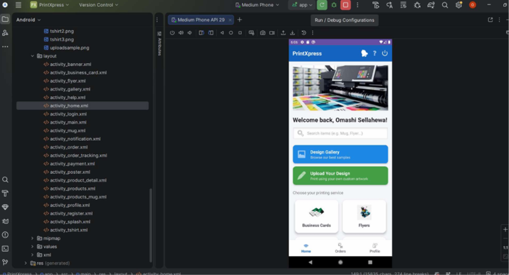
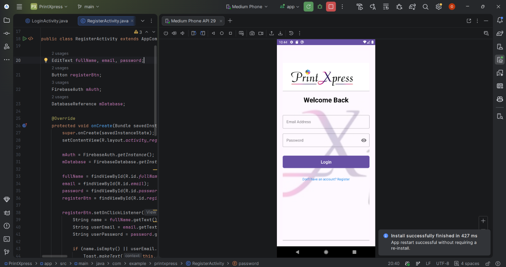
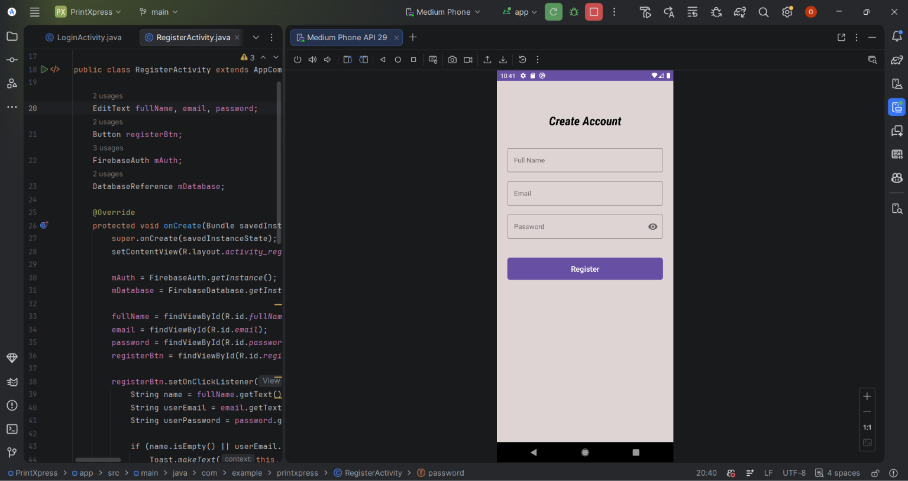
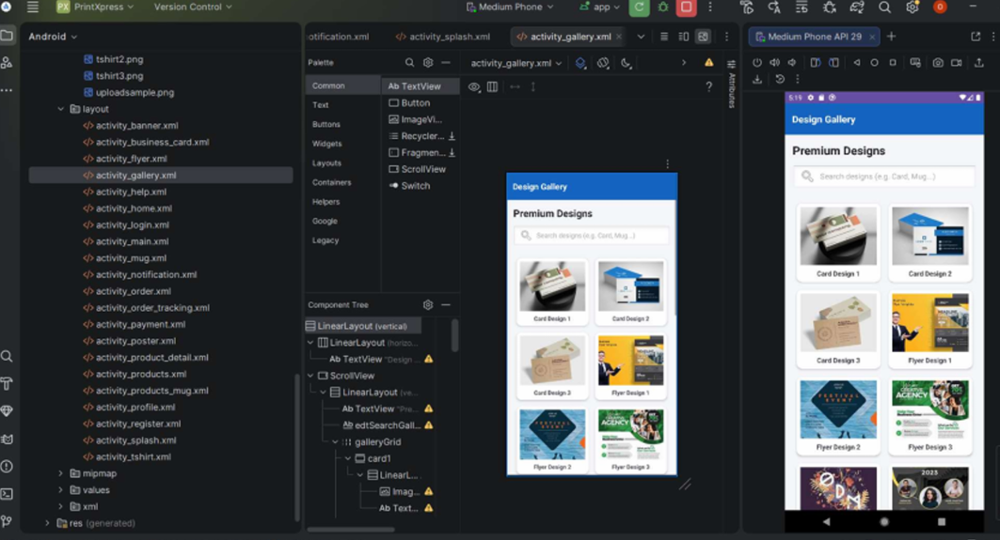
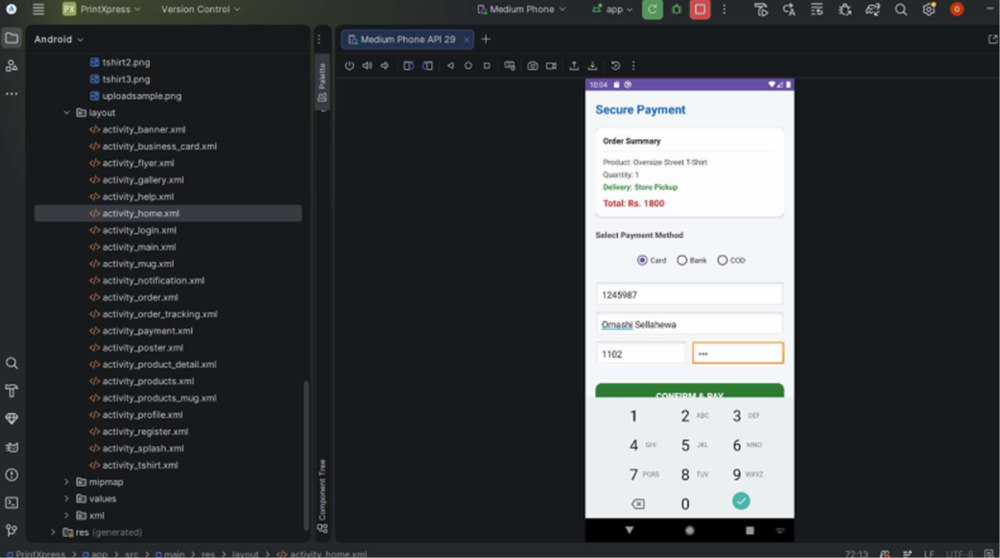
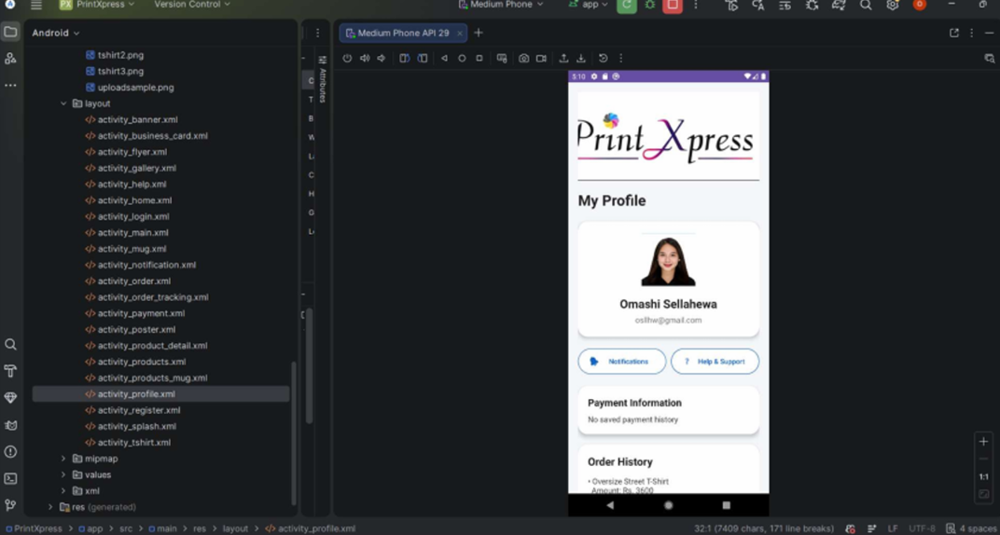
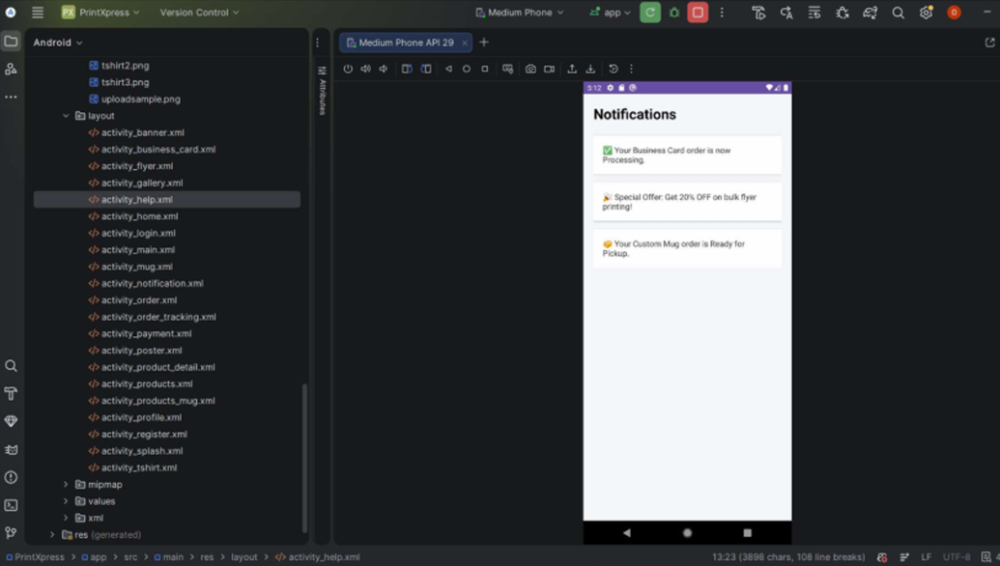
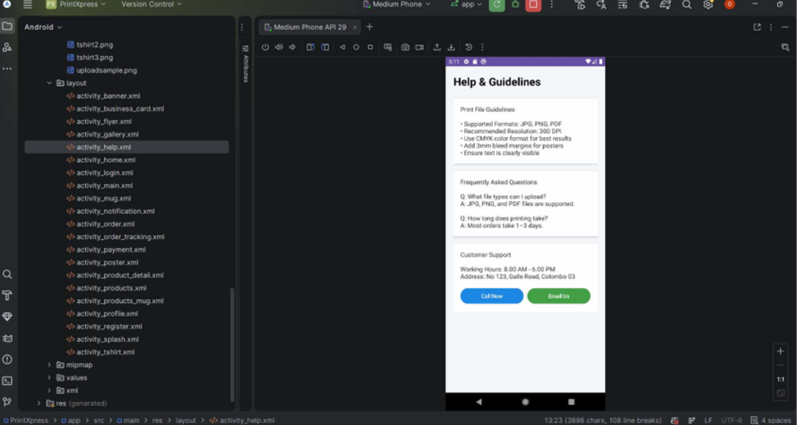

# PrintXpress – Android Application

An Android application designed to make online ordering easier and more convenient for customers.

## About the Project

PrintXpress is a mobile application developed using Java and Android Studio. It provides a convenient interface for customers to explore services, place orders, manage profiles, track order statuses, and access payment-related features.

## Features

- **User Authentication** – Customer login and registration
- **Home Screen** – Main application interface
- **Categories** – Browse available service categories
- **Online Ordering** – Submit order details
- **Order Management** – View orders and order information
- **Order Tracking** – Check order status
- **Payment Options** – Access payment-related features
- **Customer Profiles** – Manage customer information
- **Notifications** – View notifications and messages
- **Special Offers** – View promotional offers
- **Help and Support** – Access help information

## Screenshots

### Home Screen

### Login

### Registration

### Categories

### Order Form

### Order Page

### Order Confirmation

### Order Status

### Payment

### Payment Method

### Customer Profile

### Notifications

### Help

## Technologies Used

- Java
- Android Studio
- XML Layouts
- Gradle
- Firebase Authentication
- Firebase Realtime Database

## Project Structure

- `app/` – Android application source code and resources
- `gradle/` – Gradle wrapper configuration
- `screenshoot/` – Application screenshots
- `build.gradle.kts` – Project build configuration
- `settings.gradle.kts` – Gradle project settings

## Developer

**Omashi Sellahewa**

- GitHub: [@omashi0816](https://github.com/omashi0816)
- Project Repository: [PrintXpressPrintXpress](https://github.com/omashi0816/PrintXpressPrintXpress)

## Purpose

This project was developed to practise Android application development, mobile UI design, user authentication, and database integration.
